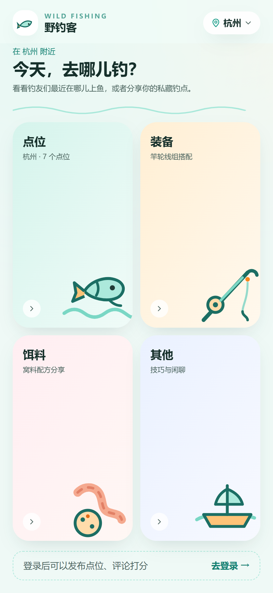
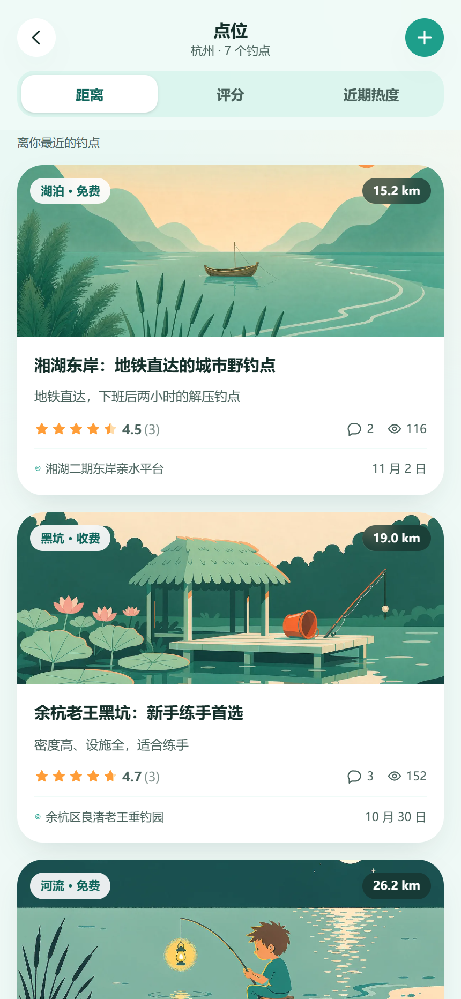
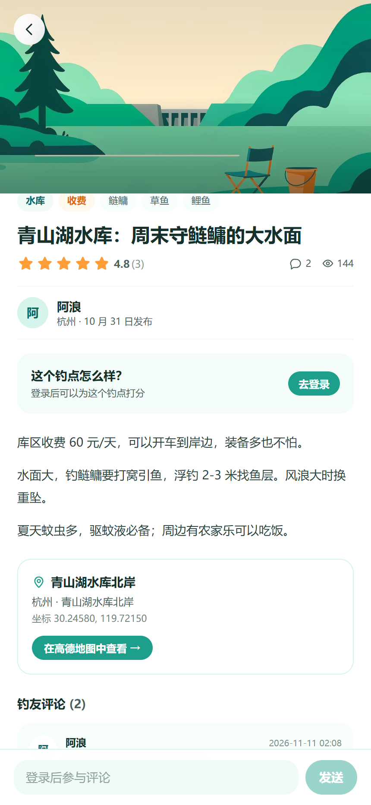
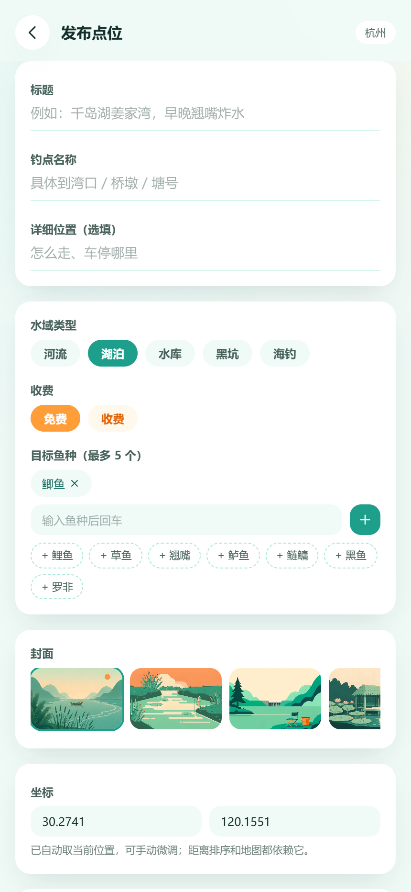

# 野钓客 · Wild Fishing

**找到身边的好钓点，也把你的私藏分享出去。**

面向钓鱼爱好者的 C 端社区：打开就知道附近哪儿能下竿，点进去能看到水情、鱼种、收费和钓友评分。
后端 FastAPI + MySQL，前端 React，移动端优先，桌面打开是一个居中的「手机屏」。

<div align="center">
<table>
<tr>
<td></td>
<td></td>
<td></td>
<td></td>
</tr>
<tr>
<td align="center"><sub>首页四个入口</sub></td>
<td align="center"><sub>按距离排序</sub></td>
<td align="center"><sub>详情 / 评分 / 评论</sub></td>
<td align="center"><sub>发布点位</sub></td>
</tr>
</table>
</div>

## 已实现

- **首页**：标题栏 + 四个分类（点位 / 装备 / 饵料 / 其他）铺满整屏，右上角显示当前城市
- **城市**：定位优先级为「上次选择 → 浏览器定位反查最近城市 → 默认城市」，支持搜索切换（城市名或拼音）
- **点位二级页**：距离 / 评分 / 近期热度三个排序 tab，卡片流 + 分页加载
- **点位详情**：封面、鱼种与收费标签、图文正文、高德地图跳转、评分、两级评论
- **发布点位**：登录后填写位置、水域、鱼种、封面与正文；坐标自动取自定位
- **账号**：邮箱注册 / 登录，JWT 鉴权；评论与打分必须登录

## 技术栈

| 层 | 选型 | 说明 |
| --- | --- | --- |
| 前端 | React 19 · TypeScript · Vite 8 · React Router 7 · Tailwind CSS 4 | 无 UI 库，组件与设计令牌自持，样式改一处生效 |
| 后端 | FastAPI 0.115 · Pydantic v2 · SQLAlchemy 2.0 | 同步 ORM + `def` 路由（FastAPI 跑在线程池），代码比 async 更好读 |
| 数据库 | MySQL 8 · Alembic | 迁移只管理 `wf_` 前缀的表，绝不动同库里的其它业务 |
| 鉴权 | PyJWT + bcrypt | 无状态 Bearer token，方便以后接小程序或 App |
| 图片 | 本地静态目录 + WebP | 六张卡通封面由 AI 生成后裁切压缩（9.3MB → 308KB） |

## 目录结构

```text
wildFishingEnthusiast/
├── backend/
│   ├── app/
│   │   ├── api/          # 路由：auth / cities / spots，deps 放鉴权依赖
│   │   ├── core/         # 配置与安全（JWT、bcrypt）
│   │   ├── db/           # 引擎、会话、声明基类
│   │   ├── models/       # 7 张表 + 枚举
│   │   ├── schemas/      # 请求 / 响应模型
│   │   ├── services/     # 业务逻辑：点位查询、评分、地理计算
│   │   └── main.py       # 应用入口
│   ├── alembic/          # 迁移脚本
│   ├── scripts/seed.py   # 可重复执行的种子数据
│   └── static/covers/    # 点位封面
└── frontend/
    └── src/
        ├── api/          # 类型 + 请求封装 + 接口集合
        ├── components/   # Header / CityPicker / SpotCard / Stars / Toast …
        ├── hooks/        # useAuth（登录态）、useCity（城市与坐标）
        ├── pages/        # 首页、列表、详情、发布、登录、占位
        └── assets/       # 手绘风 SVG 插画
```

## 数据模型

| 表 | 作用 | 关键点 |
| --- | --- | --- |
| `wf_user` | 用户 | 邮箱唯一，`password_hash` 从不进入响应 |
| `wf_city` | 城市 | 带经纬度，供定位匹配与距离计算 |
| `wf_spot` | 点位（图文） | 位置、水域、鱼种、收费 + 冗余统计字段 |
| `wf_spot_image` | 配图 | 与正文分表，封面单独存在 `cover_url` |
| `wf_comment` | 评论 | `parent_id` 自关联，只做两层（评论 + 回复） |
| `wf_rating` | 评分 | `UNIQUE(spot_id, user_id)`，一人一评，可改 |
| `wf_spot_event` | 互动事件 | 浏览 / 评论 / 打分的流水，用来算热度 |

```text
wf_city 1 ──< wf_spot >── 1 wf_user
                 │
                 ├──< wf_spot_image
                 ├──< wf_comment >── 1 wf_user
                 ├──< wf_rating  >── 1 wf_user
                 └──< wf_spot_event
```

## 几个设计决定

**1. 距离排序不在应用层做。**
点位坐标存在 `DECIMAL(9,6)`，排序交给 `ST_Distance_Sphere(POINT(lng,lat), POINT(?,?))`，只把排好序的前 N 条带回来。前端不传坐标时自动退化为热度排序，不会报错。

**2. 热度是「算」出来的，不是「存」的。**
每次浏览、评论、打分写一条 `wf_spot_event`（权重 1 / 3 / 2）。近期热度 = 近 7 天权重之和 —— 滑动窗口天然成立，不需要定时任务做衰减，也不会出现「字段和事实脱节」。

**3. 评分用唯一约束保证一人一评。**
重复提交是修改：总分做增量（`rating_sum += 新分 - 旧分`），平均分与评分人数在同一事务里更新。并发下也不会多算一次。

**4. 城市定位三级降级。**
上次手动选择的城市 > 浏览器定位反查最近城市 > 默认城市。拒绝定位授权不影响浏览，只是「距离」排序会提示开启。

**5. 迁移有护栏。**
本机 `app_user` 只能访问 `mock_prod_db`，项目表统一加 `wf_` 前缀；`alembic/env.py` 里用 `include_object` 限定只处理 `wf_` 表，避免自动生成把别人的表当垃圾删掉。

## 接口

| 方法 | 路径 | 鉴权 | 说明 |
| --- | --- | --- | --- |
| POST | `/api/auth/register` | - | 注册并返回 token |
| POST | `/api/auth/login` | - | 登录 |
| GET | `/api/auth/me` | ✓ | 当前用户 |
| GET | `/api/cities` | - | 城市列表（`keyword` / `hot_only`） |
| GET | `/api/geo/locate` | - | 坐标反查最近城市 |
| GET | `/api/spots` | - | 列表：`city_id` `sort` `lat` `lng` `page` `size` |
| POST | `/api/spots` | ✓ | 发布点位 |
| GET | `/api/spots/{id}` | 可选 | 详情（登录后带 `my_rating`） |
| GET | `/api/spots/{id}/comments` | 可选 | 评论列表 |
| POST | `/api/spots/{id}/comments` | ✓ | 发表评论 / 回复 |
| POST | `/api/spots/{id}/rating` | ✓ | 打分（重复即修改） |

完整文档：后端启动后访问 `http://localhost:8000/docs`。

## 本地运行

```bash
# 1. 后端
cd backend
python -m venv .venv
.venv/Scripts/python.exe -m pip install -r requirements.txt     # Windows
# source .venv/bin/activate && pip install -r requirements.txt  # macOS / Linux

cp .env.example .env          # 按需修改数据库连接
.venv/Scripts/python.exe -m alembic upgrade head
.venv/Scripts/python.exe -m scripts.seed
.venv/Scripts/python.exe -m uvicorn app.main:app --reload --port 8000

# 2. 前端（另开终端）
cd frontend
npm install
npm run dev                   # http://localhost:5175
```

体验账号：`demo@wild.fish` / `demo1234`（种子数据里还有 `alan@` / `xiaoyu@`，密码相同）。

> 前端通过 Vite 代理把 `/api`、`/static` 转到 `127.0.0.1:8000`，所以业务代码里全部使用相对路径，部署时改反向代理即可。

## 设计规范

| 项 | 值 |
| --- | --- |
| 主色 | 湖绿 `#1E9F8B`，浅色阶用于背景与标签 |
| 强调色 | 夕阳橙 `#FF9D38`（评分、收费） |
| 背景 | `#F7FAF9` + 两团柔光渐变 |
| 圆角 | 卡片 24px，按钮全圆角 |
| 阴影 | `0 12px 30px -12px rgba(16,60,52,.18)`，不用纯黑投影 |
| 插画 | 手绘风扁平 SVG（分类图标）+ AI 生成的场景封面 |

## 下一步

- 装备 / 饵料 / 其他三个分类的具体功能（目前是占位页）
- 图片上传（对象存储）与图文混排
- 收藏、关注钓点、按鱼种筛选
- 评论分页与举报、内容审核
- 接入真实 IP 定位库，替代「默认城市」兜底

## 已知限制

- 开发库与博客系统共用 `mock_prod_db`，生产环境应换独立库（改 `.env` 的 `DATABASE_URL` 一行即可）
- 封面是预置图，暂不支持用户上传
- 未做接口限流与验证码，上线前需补
- 定位依赖浏览器授权；HTTPS 下才稳定可用（localhost 例外）
